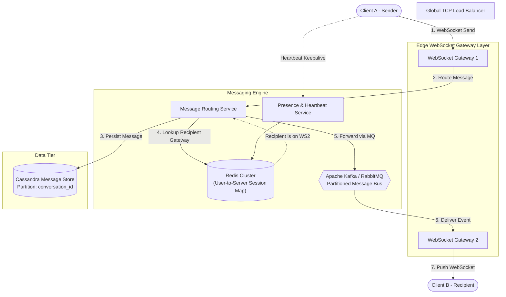
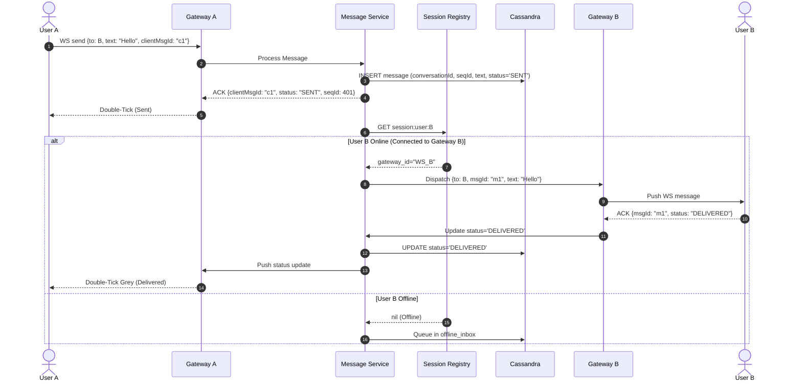

# High-Level Design: Chat & Real-Time Messaging System (WhatsApp / Slack)

## 1. Problem Statement & Scope
A globally distributed, ultra-low latency real-time messaging architecture supporting 1:1 direct messaging, multi-user group chats, user presence indication (online/last seen), and delivery receipts (Sent, Delivered, Read).

* **In-Scope**: Real-time duplex message exchange, offline queueing and synchronization, presence state, end-to-end encryption transport, group fan-out.
* **Out-of-Scope**: Voice/video streaming (WebRTC media relay), end-to-end media transcoding.

---

## 2. Requirements

### 2.1 Functional Requirements
* **FR-1 (1:1 Messaging)**: Low-latency two-way message exchange between two users.
* **FR-2 (Delivery Receipts)**: State acknowledgments: Sent (server received), Delivered (peer device received), Read (peer opened).
* **FR-3 (Offline Queueing)**: Buffer messages when recipient device is offline; deliver upon reconnect.
* **FR-4 (Group Chat)**: Multi-party messaging up to 1,000 members per group.
* **FR-5 (Presence Engine)**: Real-time broadcast of Online / Offline / Typing status with heartbeat keepalives.

### 2.2 Non-Functional Requirements
* **Latency**: p99 message delivery latency < **100 ms** for online users.
* **Availability**: 99.99% service availability.
* **Durability & Ordering**: Strict FIFO ordering per conversation thread; zero message loss.
* **Scale**: Support 500M Daily Active Users (DAU) and 25M concurrent persistent socket connections.

---

## 3. Capacity Estimation & Math
* **Messages per day**: 500M users $\times$ 40 messages/day $\approx$ **20 Billion messages/day**.
* **Average Message QPS**:
  $$\text{Average QPS} = \frac{20,000,000,000}{86,400} \approx 231,000 \text{ msgs/sec}$$
  $$\text{Peak QPS (2.5x)} \approx \mathbf{580,000 \text{ msgs/sec}}$$
* **Storage per day**: $20\text{B} \times 100 \text{ bytes (text + metadata)} \approx \mathbf{2 \text{ TB / day}}$ ($\approx 730 \text{ TB / year}$).
* **Active WebSocket Memory**: 25M concurrent connections $\times$ 10 KB OS socket buffer $\approx \mathbf{250 \text{ GB RAM}}$ across gateway clusters.

---

## 4. API Design & Protocols
* **Transport**: **WebSockets** (persistent bidirectional TCP channel) with **gRPC/Protocol Buffers** payload serialization for minimal wire overhead.
* **HTTP Fallback Endpoints**:
  * `POST /api/v1/messages`: Fallback ingestion when WebSocket fails.
  * `GET /api/v1/conversations/{id}/sync?since={seq}`: Delta synchronization of missed messages on client reconnection.

---

## 5. Data Model & Database Architecture

```sql
-- Conversations Table
CREATE TABLE conversation (
    conversation_id VARCHAR(36) PRIMARY KEY,
    is_group BOOLEAN NOT NULL DEFAULT FALSE,
    created_at TIMESTAMP WITH TIME ZONE DEFAULT CURRENT_TIMESTAMP
);

-- Message History Table (Partitioned by Conversation ID)
CREATE TABLE message (
    conversation_id VARCHAR(36),
    sequence_id BIGINT,
    message_id VARCHAR(36),
    sender_id VARCHAR(36) NOT NULL,
    payload TEXT NOT NULL,
    status VARCHAR(16) NOT NULL, -- SENT, DELIVERED, READ
    created_at TIMESTAMP WITH TIME ZONE NOT NULL,
    PRIMARY KEY (conversation_id, sequence_id)
);
```

* **Storage Engine Choice**: **Apache Cassandra (ScyllaDB)**.
  * *Justification*: Write-heavy workload (LSM-tree storage). Partitioning by `conversation_id` with `sequence_id` as clustering key guarantees sequential, range-query friendly retrieval with linear horizontal write scaling.

---

## 6. High-Level Architecture Diagram



---

## 7. Deep-Dive Workflows

### 1:1 Message Routing Sequence


