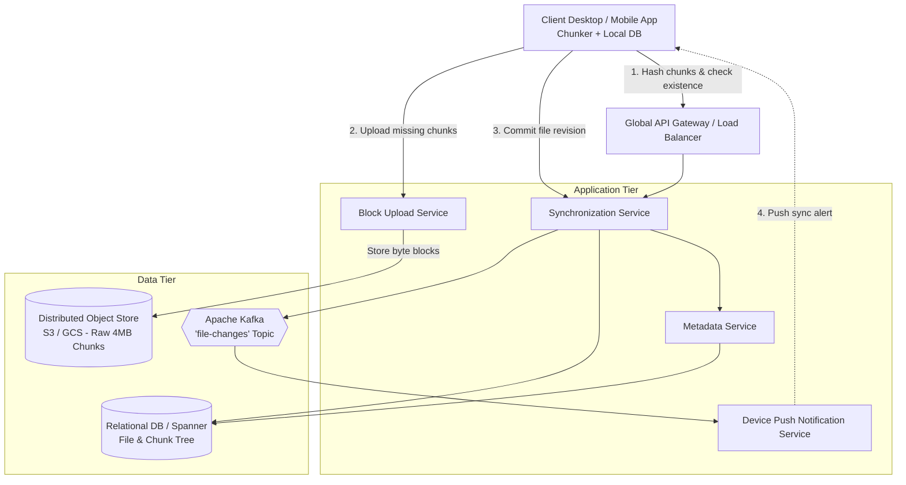

# High-Level Design: Distributed Cloud Storage & Synchronization (Dropbox / Google Drive)

## 1. Problem Statement & Scope
A globally scalable distributed cloud storage system that enables users to upload, download, and synchronize large files across multiple devices with delta synchronization, chunk-level deduplication, and high availability.

* **In-Scope**: Block-level file chunking, content-defined deduplication, client-to-server delta sync, file versioning, metadata storage, conflict resolution.
* **Out-of-Scope**: Collaborative online real-time document editing (OT/CRDT), end-user document scanning.

---

## 2. Requirements

### 2.1 Functional Requirements
* **FR-1 (Upload & Download)**: Upload and retrieve files of arbitrary sizes (up to 50 GB).
* **FR-2 (Block-Level Chunking & Deduplication)**: Files are split into 4 MB chunks. Identical chunks across different files/users are stored only once.
* **FR-3 (Delta Sync)**: When a file is edited, only modified chunks are transmitted across the network.
* **FR-4 (Cross-Device Sync)**: Changes propagate automatically to all connected user devices.
* **FR-5 (File Versioning)**: Retain up to 30 days of previous file revisions.

### 2.2 Non-Functional Requirements
* **Durability**: 99.999999999% (11 9's) data durability for stored chunks.
* **Availability**: 99.99% service availability.
* **Bandwidth Optimization**: Minimize WAN egress and mobile bandwidth via client-side chunk hashing.
* **Consistency**: Strong consistency for file metadata; eventual consistency for read-only sync fan-out.

---

## 3. Capacity Estimation & Math
* **User Base**: 50M Daily Active Users (DAU).
* **Daily File Ingest**: 100M file updates/day.
* **Average File Size**: 2 MB (average 1 modified chunk of 2 MB).
* **Daily Ingress Bandwidth**:
  $$\text{Daily Ingress} = 100\text{M} \times 2 \text{ MB} = 200 \text{ TB / day}$$
  $$\text{Average Bandwidth} \approx \frac{200 \times 10^{12} \times 8}{86,400} \approx \mathbf{18.5 \text{ Gbps}}$$
* **Chunk Storage over 5 Years**: $\approx \mathbf{150 \text{ PB}}$ raw block storage before deduplication (dedup reduces storage by $\approx 40\%$).

---

## 4. API Design & Interface Contracts
* `POST /api/v1/files/chunks/check`: Checks if chunk hashes already exist on server (deduplication check).
  * Payload: `{"chunkHashes": ["sha256_hash_1", "sha256_hash_2"]}`
  * Response: `{"missingHashes": ["sha256_hash_2"]}`
* `PUT /api/v1/files/chunks/{hash}`: Uploads a missing raw chunk payload.
* `POST /api/v1/files/commit`: Atomically links uploaded chunks into a new file metadata revision.

---

## 5. High-Level Architecture Diagram



---

## 6. Deep-Dive Workflows: Delta Sync & Chunk Deduplication

```mermaid
sequenceDiagram
    autonumber
    actor User as User Device A
    participant App as Local Sync Client
    participant API as Sync API Gateway
    participant DB as Metadata Store
    participant Blob as Object Store (S3)

    User->>App: Edits 50 MB File
    App->>App: Split into 4MB chunks & compute SHA-256
    App->>API: POST /chunks/check {hashes: [H1..H13]}
    API->>DB: Query existing hashes
    DB-->>API: H1..H12 exist; H13 is new
    API-->>App: Upload only {H13}
    App->>Blob: PUT /chunks/H13 (Raw bytes)
    Blob-->>App: 200 OK
    App->>API: POST /files/commit {fileId, version: 2, chunkList: [H1..H13]}
    API->>DB: Atomically insert new revision
    API-->>App: 200 Commit Success
```
