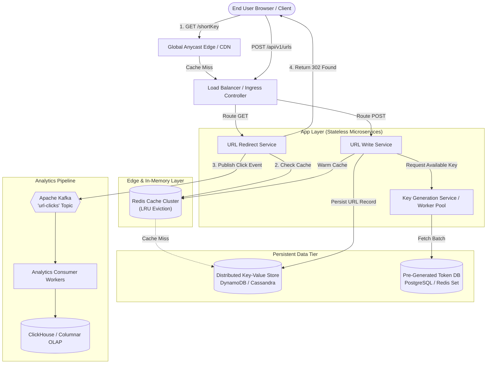
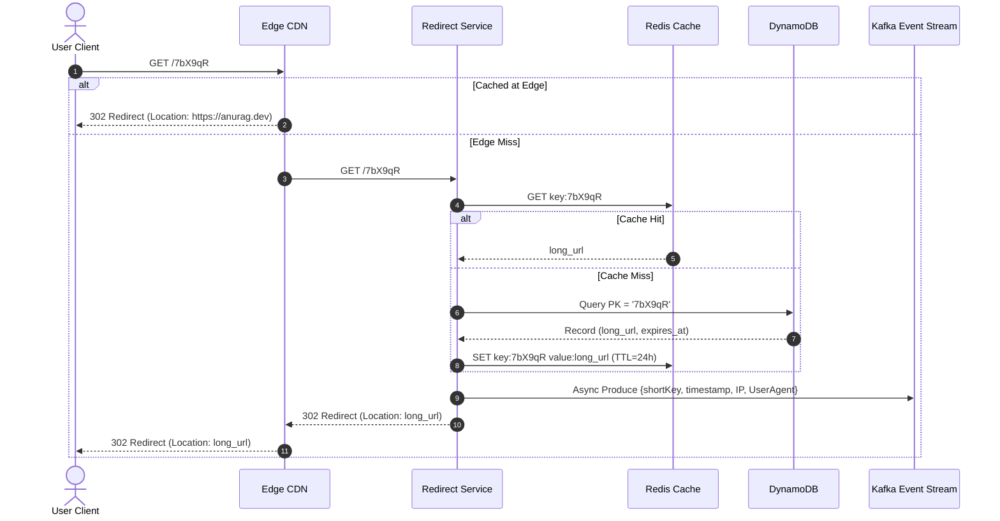

# High-Level Design: Distributed URL Shortener (TinyURL)

## 1. Problem Statement & Scope
A globally distributed URL shortening service that converts long URLs into compact, unique aliases (e.g., `https://tiny.dev/7bX9qR`) and transparently redirects users to the original long URL with sub-15ms p99 latency.

* **In-Scope**: Short URL generation, custom vanity aliases, HTTP 301/302 redirects, URL expiration (TTL), analytics tracking (click counts, geo-distribution).
* **Out-of-Scope**: Malicious URL crawling/sandboxing, ad injection, user authentication management.

---

## 2. Requirements

### 2.1 Functional Requirements
* **FR-1 (Shorten)**: Given a long URL, return a unique, compact alias (7 characters).
* **FR-2 (Redirect)**: Given a short alias, redirect the HTTP client to the original long URL with minimal latency.
* **FR-3 (Custom Alias)**: Allow users to specify an optional custom vanity alias (e.g., `tiny.dev/my-campaign`, max 16 chars).
* **FR-4 (TTL / Expiration)**: Users can specify an optional expiration date; expired links return HTTP 410 (Gone).
* **FR-5 (Analytics)**: Record access events (timestamp, IP, referer, user agent) asynchronously.

### 2.2 Non-Functional Requirements
* **Availability**: 99.99% for read/redirection operations (CAP: High Availability preferred over strict consistency on redirect).
* **Latency**: 
  * Read Path: p99 latency < **15 ms** at the edge.
  * Write Path: p99 latency < **100 ms**.
* **Durability**: Zero data loss once a short link is created ($RPO = 0$).
* **Security & Predictability**: Generated URLs must not be sequential to prevent brute-force enumeration attacks.

---

## 3. Capacity Estimation & Back-of-the-Envelope Math

### 3.1 Traffic Estimations
* **New URLs Created**: 100 million new URLs per month $\approx 3.33 \text{ million URLs/day}$.
* **Write QPS**:
  $$\text{Write QPS} = \frac{3,330,000}{86,400 \text{ sec}} \approx 40 \text{ writes/sec}$$
  $$\text{Peak Write QPS (3x)} \approx 120 \text{ writes/sec}$$
* **Read-to-Write Ratio**: $100 : 1$ (heavily read-dominated).
* **Read QPS**:
  $$\text{Read QPS} = 40 \times 100 = 4,000 \text{ reads/sec}$$
  $$\text{Peak Read QPS (2.5x)} \approx 10,000 \text{ reads/sec}$$

### 3.2 Storage Estimations
* **Data Model Size per Record**:
  * `short_key`: 7 bytes (Base62)
  * `long_url`: 500 bytes (average)
  * `created_at`: 8 bytes
  * `expires_at`: 8 bytes
  * `user_id`: 16 bytes (UUID)
  * Index / overhead: $\approx 100$ bytes
  * **Total per Record**: $\approx 640$ bytes
* **Storage per Year**:
  $$3.33 \text{M} \times 365 \times 640 \text{ bytes} \approx 778 \text{ GB / year}$$
* **5-Year Storage Capacity**:
  $$778 \text{ GB} \times 5 \approx 3.9 \text{ TB}$$ (Replication factor of 3 requires $\approx 12 \text{ TB}$ raw disk).

### 3.3 Memory & Cache Estimations (80/20 Rule)
* 20% of the daily URLs generate 80% of daily redirect traffic.
* Daily read requests: $4,000 \times 86,400 \approx 345 \text{ million redirects/day}$.
* Daily unique hot URLs to cache ($20\% \text{ of daily writes}$ plus active historical working set):
  * Cache working set: 30 million URLs.
  * Memory required: $30,000,000 \times 600 \text{ bytes} \approx \mathbf{18 \text{ GB RAM}}$.

---

## 4. API Design & Interface Contracts

### 4.1 Shorten URL
* **Endpoint**: `POST /api/v1/urls`
* **Headers**: `Content-Type: application/json`, `Idempotency-Key: <UUID>`

```json
{
  "longUrl": "https://anurag.dev/handbook/system-design/distributed-systems",
  "customAlias": "sys-design",
  "ttlSeconds": 2592000
}
```

### 4.2 Redirect Short URL
* **Endpoint**: `GET /{shortKey}`
* **Response**: `HTTP 302 Found` (or `307 Temporary Redirect`)
* **Headers**: `Location: https://anurag.dev/...`

---

## 5. Data Model & Database Architecture

```sql
-- Core Mapping Table
CREATE TABLE url_mapping (
    short_key VARCHAR(16) PRIMARY KEY,
    long_url VARCHAR(2048) NOT NULL,
    user_id VARCHAR(36),
    created_at TIMESTAMP WITH TIME ZONE DEFAULT CURRENT_TIMESTAMP,
    expires_at TIMESTAMP WITH TIME ZONE NULL
);
CREATE INDEX idx_url_mapping_expires_at ON url_mapping (expires_at);

-- Click Telemetry (Append-only)
CREATE TABLE url_access_event (
    event_id BIGINT PRIMARY KEY,
    short_key VARCHAR(16) NOT NULL,
    accessed_at TIMESTAMP WITH TIME ZONE NOT NULL,
    ip_hash VARCHAR(64),
    referer VARCHAR(512),
    user_agent VARCHAR(256),
    geo_country CHAR(2)
);
```

---

## 6. High-Level Architecture Diagram



---

## 7. Deep-Dive Workflows

### Read Execution Sequence



